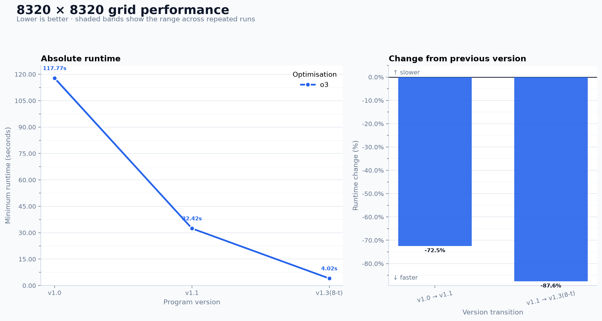

# Forest fire simulation


A cellular automata forest fire simulation written in C++ for COSC3500. This
project explores how SIMD and parallel computing can accelerate a simple
simulation. Combining AVX2 SIMD with eight OpenMP threads achieved roughly a
30× speedup over the serial implementation on an 8320 × 8320 grid.

Each cell is empty, a tree, or burning. Empty cells grow trees with probability
`p`. Trees catch fire with probability `f` or when one of their four neighbours
is burning. Burning cells become empty on the next timestep. All cells update
synchronously using separate current and next grids.

## Implementation

The optimised implementation processes 32 cells at a time with AVX2 intrinsics
and distributes rows across OpenMP threads. Each thread has its own random
number generator, and the threads synchronise before swapping grids at each
timestep. Optional frame recording supports playback with a Python animation
tool.

## Performance



The chart compares serial `v1.0`, AVX2 SIMD `v1.1`, and AVX2 with eight OpenMP
threads `v1.3`. Minimum elapsed wall times across five runs were 117.77 s,
32.42 s, and 4.02 s respectively, giving a 29.3× overall speedup.

Each run used 500 timesteps, `p=0.02`, and `f=0.01`, with an `-O3` build on an
AMD EPYC 7542 processor. Timings include startup and allocation, with frame
recording disabled.

## Build and run

Requires an AVX2-capable CPU, a C++17 compiler with OpenMP support, and Make.
The build uses GCC-specific headers and pragmas, so GCC is recommended.

```sh
make o3
OMP_NUM_THREADS=8 ./bin/fire-v1.4-o3 256 500 0.02 0.01
```

Arguments are the interior grid width, timestep count, tree-growth probability,
and spontaneous-fire probability. The current SIMD implementation requires a
positive grid width divisible by 32. The simulation adds a one-cell empty border
on each side.

## Repository overview

- `main.cpp` contains the AVX2 and OpenMP simulation; `serial.cpp` contains the serial baseline.
- `save_file.cpp` handles frame recording, and `tools/animation/` provides playback.
- `bench.sh`, `run.slurm.sh`, and `tools/plot_benchmarks.py` run and plot benchmarks.
- `data/` and `plots/` contain recorded measurements and performance charts.
- `notes/` and `presentation/` contain development notes and milestone presentation material.

## Milestone videos

- [Milestone 1 presentation](https://youtu.be/l-9ioKjfn4M)
- [Milestone 2 presentation](https://youtu.be/T6NX9o81n3o)
